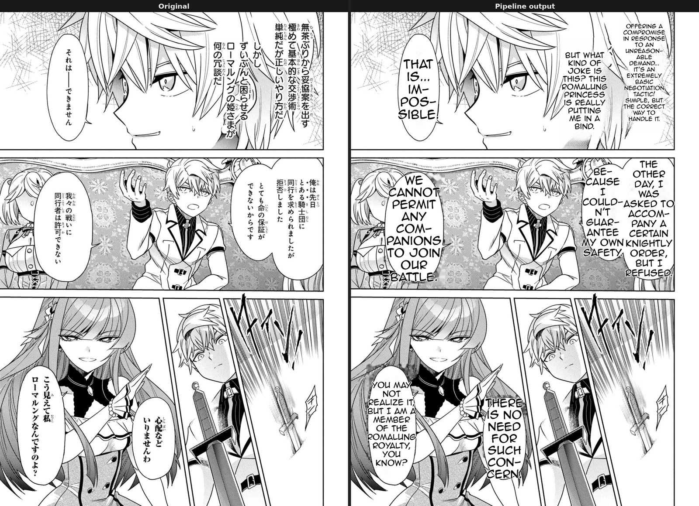
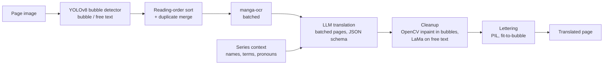
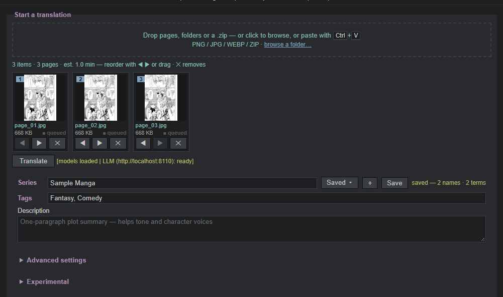
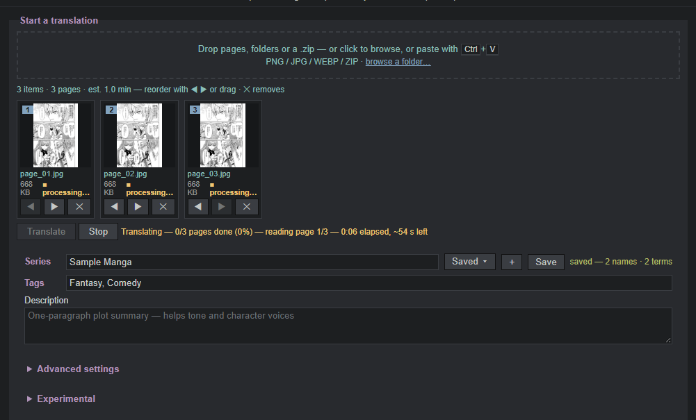
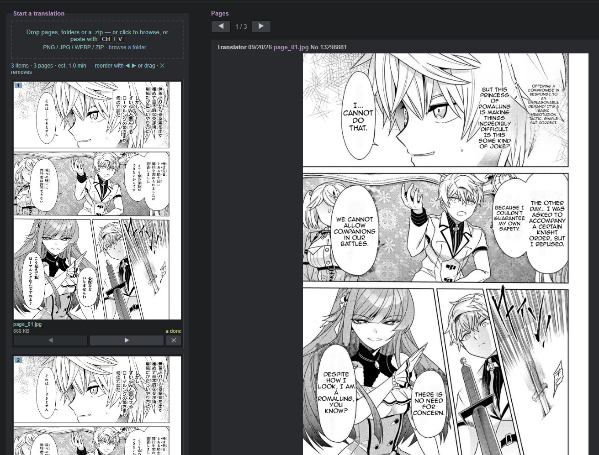
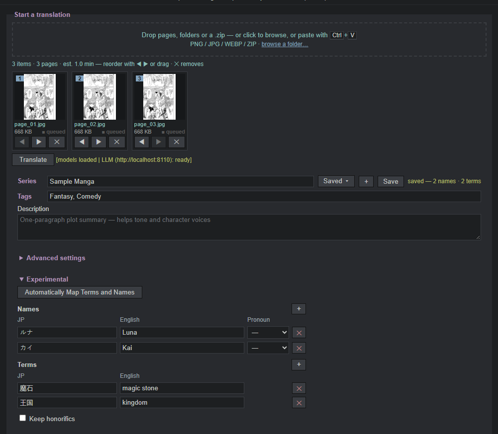
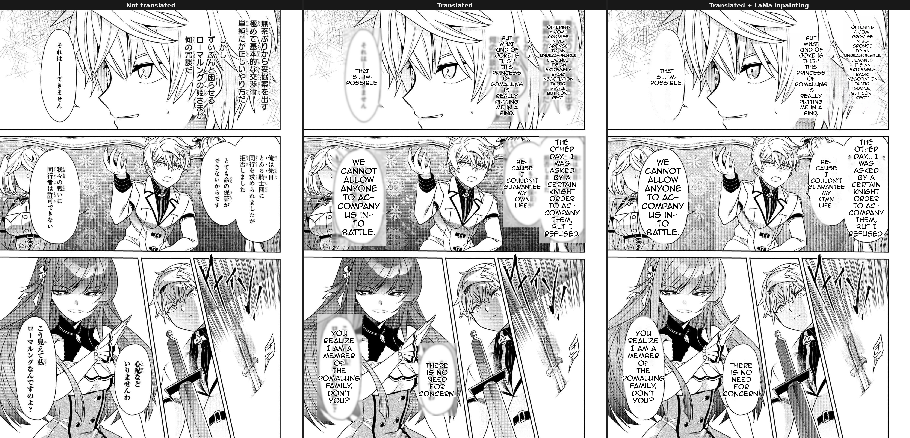

# Multi-Modal Manga Translation Pipeline

Detects, reads, translates and re-letters Japanese manga pages, running locally by default. It chains a vision detector, a manga-specific OCR model, an LLM and an image inpainting model, and ships with a web UI that streams translated pages back as they finish.



*Left: the source page. Right: the pipeline's output (detection, OCR, Gemma 4 26B translation, OpenCV + LaMa cleanup, lettering), cropped from [`013_comparison.png`](013_comparison.png). This sample was rendered before lettering switched to whole-word wrapping, so a few words are still hyphenated.*

## What it does



| Stage | What runs | Why this choice |
|---|---|---|
| Detection | [ogkalu/comic-speech-bubble-detector-yolov8m](https://huggingface.co/ogkalu/comic-speech-bubble-detector-yolov8m) via ultralytics | A pretrained comic bubble detector that separates speech bubbles from free-floating text, so each region can be cleaned differently. Overlapping boxes are merged and regions are sorted top-to-bottom, right-to-left (manga reading order). |
| Region typing | Edge-ink ratio on each crop | Decides whether a detection is a balloon (outline touches the crop edge), a rectangular caption box, or free text. This picks the cleanup mask. |
| OCR | [kha-white/manga-ocr](https://github.com/kha-white/manga-ocr) | Trained on manga, handles vertical text and furigana. All crops on a page go through one batched `generate()` call; small crops are upscaled 2x first. |
| Translation | Any OpenAI-compatible endpoint (default: local llama.cpp) | Several pages go to the LLM in one request so dialogue keeps context across pages. Series title, tags, description, a names/terms map and per-character pronouns are injected into the prompt. Output is constrained with a JSON schema (one entry per bubble id) where the server supports it; malformed or partial responses are re-asked in halves instead of falling back to one call per bubble. |
| Cleanup | OpenCV inpainting inside bubbles, [LaMa](https://github.com/enesmsahin/simple-lama-inpainting) on free text | OpenCV inpainting is fast and keeps balloon outlines and tails intact; LaMa is only run on padded crops around free text, where the background is artwork. |
| Lettering | PIL | Per-bubble font sizing with shape-aware margins, whole-word wrapping (shrinks before it hyphenates), names from the map never split, white outline for readability, very tall vertical columns rendered rotated. |

## Features

- **Web UI with streaming results.** Each page appears in the viewer as soon as it is lettered. **Stop** cancels at the next page boundary and keeps finished pages.
- **Comparison workspace.** Originals scroll on the left, the translated page sits in a viewer on the right; arrow keys flip pages. Reader view supports RTL/LTR order, two-page spreads and "Download all".
- **Per-series configuration.** Title, tags, description and a names/terms table (JP, EN, pronoun) are saved per series and reloaded by title. **Automatically Map Terms and Names** asks the LLM to draft the table from the chapter's OCR text.
- **Bring your own LLM.** llama.cpp by default; Ollama, LM Studio, vLLM or a hosted API work by entering a base URL, API key and model name. Servers without JSON-schema support are detected and handled.
- **Inputs.** Single pages, folders and `.zip` files, paste with Ctrl+V, reorderable queue, time estimates learned from your previous runs.
- **Comparison sheets.** Optional three-panel PNG per page (original, legacy blur cleanup, current cleanup) for visual checks.

## Quickstart

Python 3.10 to 3.12 on Linux, macOS or WSL2 (native Windows also works). A CUDA GPU is recommended; CPU-only works and the device is auto-detected.

```bash
# 1. clone + venv
git clone https://github.com/ArsVie/Multi-Modal-Manga-Translation-Pipeline
cd Multi-Modal-Manga-Translation-Pipeline
python3 -m venv .venv && source .venv/bin/activate      # Windows: .venv\Scripts\activate

# 2. dependencies: install torch FIRST, matching your driver.
#    Pick the index URL at pytorch.org/get-started/locally (CPU-only: drop --index-url)
pip install torch torchvision --index-url https://download.pytorch.org/whl/cu130
pip install -r requirements.txt

# 3. detector weights (~52 MB)
pip install -U huggingface_hub                          # provides the `hf` CLI
hf download ogkalu/comic-speech-bubble-detector-yolov8m comic-speech-bubble-detector.pt --local-dir .

# 4. lettering font: any comic-style .ttf/.otf saved as animeace2_reg.ttf in the
#    project root (the samples use Anime Ace 2.0 from blambot.com, not bundled),
#    or set FONT_PATH=/path/to/font

# 5. an LLM endpoint (any OpenAI-compatible server), for example:
#    Ollama:     ollama pull gemma3:27b   -> base URL http://localhost:11434, model "gemma3:27b"
#    llama.cpp:  see "Local LLM server" below
#    hosted API: enter base URL, API key and model name in the web UI

# 6. run the web UI
uvicorn server:app --host 0.0.0.0 --port 8000
# open http://localhost:8000, drop pages / a folder / a .zip, press Translate

# 7. optional: end-to-end check on the bundled sample page
python scripts/smoke.py --llm http://localhost:8110
```

The first run downloads manga-ocr (~410 MB) and big-lama (~196 MB). `server.py` also reads `YOLO_MODEL`, `FONT_PATH`, `LLM_BASE_URL` and `LLM_MODEL` from the environment.

## Web UI



Pages stream into the viewer while the run is going, and **Stop** keeps whatever already finished:



After a run, the layout becomes a comparison workspace:



Series context and the names/terms tables are saved per series. Load one from the **Saved** picker, or fill it in and press **Save**:



Advanced settings (stored in the browser) cover the LLM URL, key and model, lettering size, batch size, detection confidence, keep-honorifics and comparison sheets.

### HTTP API

`POST /translate` (multipart: `files` plus the same settings fields) streams NDJSON: one `{"type": "page", "filename", "translated_b64", "comparison_b64"}` line per finished page, then `{"type": "done", "cancelled"}` (or `{"type": "error", "message"}`). `POST /cancel` stops the running job at its next page boundary. `GET /status` reports model load state, LLM readiness and job progress.

### Python

```python
from MangaTranslator import MangaTranslator

t = MangaTranslator(
    yolo_model_path="comic-speech-bubble-detector.pt",
    font_path="animeace2_reg.ttf",
    llm_base_url="http://localhost:8110",
    custom_translations={"ルーグ": "Lugh"},  # names map, applied before translation
)

t.process_chapter(
    input_folder="raw_chapter/",
    output_folder="translated_chapter/",
    series_info={
        "title": "Sekai Saikou no Ansatsusha",
        "tags": "Action, Fantasy, Romance",
        "description": "One-paragraph plot summary; helps tone and name consistency.",
    },
    batch_size=4,           # pages translated together in one context
    save_comparisons=True,  # also write <page>_comparison.png per page
)
```

## Local LLM server

The reference setup is Gemma 4 26B-A4B (Q4_K_M GGUF) served by llama.cpp with reasoning off. MoE experts stay on the CPU so it fits next to the vision models on an 8 GB GPU:

```bash
llama-server \
  -m /path/to/gemma-4-26B-A4B-it-UD-Q4_K_M.gguf \
  --cpu-moe -ngl 99 -fa on -ctk q8_0 -ctv q8_0 -c 32000 --no-mmap \
  --reasoning off --jinja --host 127.0.0.1 --port 8110
```

The author's setup also adds an MTP draft head for speculative decoding; those flags depend on your llama.cpp build, so they are left out here. Qwen3.6-35B-A3B runs the same way. `curl http://localhost:8110/health` returns `200` once the model is loaded and `503` while it is still loading.

**Measured by the author** (RTX PRO 1000 8 GB laptop GPU + DDR5, Gemma 26B-A4B Q4_K_M with MTP): about 17 to 29 tokens/s generation, and a 3-page chapter translated in about a minute. There is no benchmark script in the repo yet, so treat these as one machine's numbers.

## Cleanup comparison

`save_comparisons=True` (or the web toggle) writes `<page>_comparison.png`:



*Left: original. Middle: the first version's cleanup (Gaussian blur per bubble). Right: the current default (OpenCV inpainting inside bubbles, LaMa over free text).*

## Configuration

| Parameter | Default | Meaning |
|---|---|---|
| `yolo_model_path` | `comic-speech-bubble-detector.pt` | YOLOv8 weights |
| `llm_base_url` / `llm_model` | `http://localhost:8110` / `local` | LLM endpoint |
| `api_key` | `None` | sent as `Authorization: Bearer` when set |
| `font_path` | `animeace2_reg.ttf` | lettering font |
| `custom_translations` | `{}` | JP to EN names/terms map |
| `keep_honorifics` | `False` | re-attach -san / -chan / ... when the source has them |
| `font_scale` | `1.0` | lettering size lever (lower shrinks text) |
| `device` | auto | `cuda` / `cpu` |
| `debug` | `True` | write `chapter_data.json` next to the output |
| `process_chapter(conf_threshold=)` | `0.15` | detector confidence threshold |
| `process_chapter(batch_size=)` | `4` | pages per translation batch |

## Project layout

```
MangaTranslator.py   pipeline: detection, OCR, translation, cleanup, lettering
server.py            FastAPI app: streaming /translate, /cancel, series configs, name suggestions
index.html           single-file web UI (no build step)
scripts/smoke.py     setup check: assets + LLM endpoint, then one page end to end
013_og.jpg           sample input page used by the smoke test
```

## Testing

There is no unit test suite yet. `scripts/smoke.py` is the end-to-end check: it verifies the detector weights, font and LLM endpoint, then translates `013_og.jpg` and writes `smoke_out/translated.jpg` and `comparison.png`. Exit codes: `0` ok, `1` missing asset, `2` LLM endpoint problem. If the LLM fails mid-run, pages are still lettered with whatever was translated and the rest keep their original text.

## Troubleshooting

- **"LLM server ... is not reachable"**: start the LLM server first; `curl http://localhost:8110/health` (503 = still loading, 200 = ready).
- **Translations time out**: each LLM call has a 240 s timeout. A model that is mostly swapped to disk or sharing the GPU with other jobs can be too slow; use a smaller model or a hosted endpoint.
- **No bubbles detected**: lower `conf_threshold` (for example `0.10`).
- **CUDA out of memory**: pass `device="cpu"`, or free VRAM (the LLM server holds about 2.5 GB in the reference setup).
- **Some sound effects stay Japanese**: the detector only finds the bubbles and free text it was trained on; SFX are often missed.

## Known limitations

- Detection quality is bounded by the pretrained detector (trained on about 8k manga, webtoon and comic pages per its model card); unusual layouts can be missed.
- One page group is one LLM call; very large batches can exceed the server context window (`-c`).
- No SFX translation, and no automated translation-quality metric yet: quality has been judged by eye on sample pages.
- Japanese to English only.
- One translation job at a time per server process.

## Credits

- Bubble detector: [ogkalu/comic-speech-bubble-detector-yolov8m](https://huggingface.co/ogkalu/comic-speech-bubble-detector-yolov8m) (ultralytics YOLOv8)
- OCR: [kha-white/manga-ocr](https://github.com/kha-white/manga-ocr)
- Inpainting: [simple-lama-inpainting](https://github.com/enesmsahin/simple-lama-inpainting) (LaMa)
- Font: Anime Ace 2.0 by Blambot (not bundled)
- Local LLM runtime: [llama.cpp](https://github.com/ggml-org/llama.cpp)

## License

Code: MIT (see [LICENSE](LICENSE)). The sample manga page and its derived images are included only to demonstrate the pipeline; their copyright stays with the original rights holders. Use the tool on material you have the right to translate.
